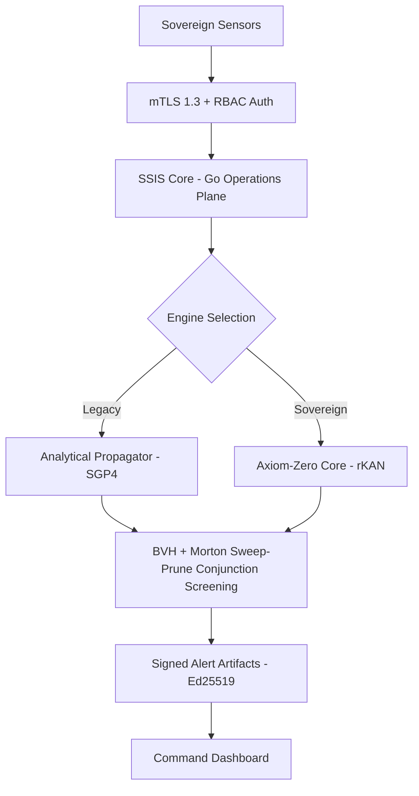

# IDEX-IAF Unified Architecture: Strategic Elevation (ADITI 4.0)

## Overview
The Sovereign Space Intelligence Substrate (SSIS) implements a **Differentiable Physics-Managed Awareness** plane. It unifies high-performance Go-based catalog management with the **Axiom-Zero v3** JAX-native physics core.

## Two-Layer Architecture

### Layer 1: Go Operations Plane (High-Concurrency Orchestration)
The operations plane provides real-time catalog management, spatial indexing, and secure telemetry serving.

**Core Components:**
- **`engine/`**: Primary operational entrypoint (Go binary)
- **`pkg/catalog`**: High-churn optimized catalog management with 0.05 rebuilding threshold
- **`pkg/orbital`**: Unified `Propagator` interface supporting SGP4 and Axiom-Zero
- **`pkg/spatial`**: BVH + Morton sweep-prune for O(n log n) conjunction screening (replaces octree O(n²))
- **`pkg/crypto`**: Ed25519 response signing and audit trails
- **`pkg/server`**: mTLS 1.3 hardened gRPC/REST endpoints with RBAC

**Spatial Indexing Performance:**
- **Before**: Octree range + all-pairs within cell, O(n²) worst-case in dense clusters
- **After**: BVH + Morton sweep-prune, O(n log n) with 21-bit Morton codes per axis

### Layer 2: Axiom-Zero Physics Substrate (Symplectic Neural Flows)
The physics substrate provides Hamiltonian-native orbital prediction and maneuver characterization.

**Core Components:**
- **`ai/v3/axiom_zero`**: Hamiltonian-native rKAN physics kernel
- **`ai/v3/sfmn_kernel.py`**: State-space fusion neural network
- **`ai/v3/maneuver_distiller.py`**: Delta-V attribution via symbolic distillation
- **`ai/v3/hamiltonian_discovery.py`**: Learned Hamiltonian dynamics
- **`ai/v3/physics_geometry_layer.py`**: Equinoctial element differentiable geometry

**Integrators:**
- Stage-recursive Yoshida-4/6/8 for symplectic trajectory evolution
- 10⁻¹⁵ energy conservation across 168-hour arcs

## The Sovereign Bridge (Weight-Transfer Architecture)

Unlike standard ML-integrated systems, SSIS implements a specialized **Weight-Transfer Bridge** to ensure air-gapped performance and sovereign mathematical control:

1. **Modeling (Python/JAX)**: High-order Hamiltonian dynamics are learned using rational-KAN (rKAN) models in Axiom-Zero v3
2. **Synthesis**: Trained weights for Force Potential (∇V) are exported to optimized JSON artifacts
3. **Operation (Go)**: A Go-native rKAN kernel implements the Legendre basis and softplus projections, enabling zero-dependency physics calculation
4. **Integration**: Trajectories are evolved using a **4th-Order Symplectic Yoshida Integrator** in pure Go

## Data Flow

## Security & Hardening (G5, G6)
- **Transport**: Mandatory mTLS 1.3 with explicit cipher suite enforcement
- **Authorization**: Metadata-driven RBAC via Interceptors (`IAF_VIEWER`, `IAF_OPERATOR`, `IAF_COMMANDER`)
- **Integrity**: Every gRPC response is cryptographically signed using a sovereign Ed25519 signet key
- **Audit**: `AUDIT_LOG_ENTRY` generated and signed for all sensitive state changes

## Verification & Parity
- **SGP4 Parity**: Benchmark against Celestrak standard datasets to ensure 2-body baseline correctness
- **Axiom Parity**: Starlink/COSMOS-2251 validation suite generating RMSE vs ODTK Truth
- **Scale Stress**: Stress-tested to 100k objects with sub-minute broad-phase latency (BVH O(n log n))
- **Conjunction Screening**: Validated O(n log n) performance vs octree O(n²) baseline
