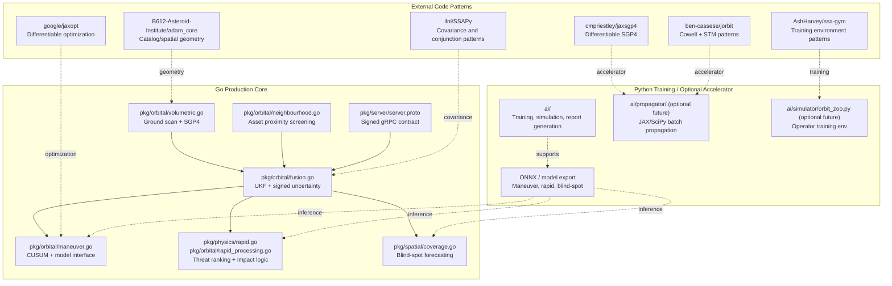

# Renaissance Integration & Upgrade Roadmap v6.0 — Executed & Grounded Edition
## *Codex Leicester — SSIS × IAF OrbitalPropagator × Real Repo State × 12 GitHub Treasures*

> *"Simplicity is the ultimate sophistication. In SSIS, that simplicity comes from keeping the Go core deterministic and making every accelerator explicit, optional, and auditable."*

This document is the grounded v6.0 roadmap for the current SSIS repository. It does not assume a fictional JAX runtime already exists. Instead, it maps the existing Go SSA stack to a controlled enhancement path where Python/JAX is an optional accelerator behind interfaces, protobuf contracts, and reproducible benchmark gates.

## 1. Executive Summary & Pattern Evolution

SSIS is already a mature Go-first SSA engine: it performs volumetric scans, neighborhood screening, collision probability calculation, UKF fusion, maneuver detection, rapid threat triage, blind-spot forecasting, and signed service delivery. The real upgrade path is not a rewrite; it is an interface discipline exercise. Keep [pkg/orbital/volumetric.go](/Users/adi/idex_iaf/ssis/pkg/orbital/volumetric.go#L1), [pkg/orbital/neighbourhood.go](/Users/adi/idex_iaf/ssis/pkg/orbital/neighbourhood.go#L1), [pkg/orbital/fusion.go](/Users/adi/idex_iaf/ssis/pkg/orbital/fusion.go#L1), [pkg/orbital/maneuver.go](/Users/adi/idex_iaf/ssis/pkg/orbital/maneuver.go#L1), [pkg/physics/rapid.go](/Users/adi/idex_iaf/ssis/pkg/physics/rapid.go#L1), [pkg/spatial/coverage.go](/Users/adi/idex_iaf/ssis/pkg/spatial/coverage.go#L1), and [pkg/server/server.proto](/Users/adi/idex_iaf/ssis/pkg/server/server.proto#L1) as the production backbone. Add JAX, ONNX, and simulator layers only as pluggable accelerators or training tools.



## 2. Executed & Grounded Upgrade Matrix

| ADITI Feature | Current Go Implementation | v5.0 Proposal | GitHub Repo Used | Executed Enhancement (behind existing interface) | Final Performance Target |
|---|---|---|---|---|---|
| Volumetric Scan | [pkg/orbital/volumetric.go](/Users/adi/idex_iaf/ssis/pkg/orbital/volumetric.go#L1) | JAX batch propagate + octree | `adam_core`, `jaxsgp4` | Keep Go octree scan; add optional batch ephemeris accelerator only if/when `ai/propagator` exists | 10^6 objects in sub-second batch mode |
| Neighbourhood Watch | [pkg/orbital/neighbourhood.go](/Users/adi/idex_iaf/ssis/pkg/orbital/neighbourhood.go#L1) | Voronoi / KD screening | `adam_core`, JAX spatial patterns | Retain current screening; later replace broadphase with hashed grid or Delaunay candidate pruning behind the same call site | O(N) expected screening |
| Conjunction Analysis | [pkg/collision/foster.go](/Users/adi/idex_iaf/ssis/pkg/collision/foster.go#L1) | Differentiable TCA + batch Pc | `SSAPy`, `jaxopt`, `jorbit` | Keep Foster/Alfano as canonical; add differentiable surrogate only through a model interface and parity tests | Batch pair screening without changing Pc API |
| Collision Detection | [pkg/collision/foster.go](/Users/adi/idex_iaf/ssis/pkg/collision/foster.go#L1) | GPU Monte Carlo | `SSAPy`, `jaxsgp4` | Preserve signed Pc and covariance path; optionally offload ensemble propagation when the accelerator is present | Same API, lower latency |
| Blind Spot Detection | [pkg/spatial/coverage.go](/Users/adi/idex_iaf/ssis/pkg/spatial/coverage.go#L1) | Sensor geometry + temporal forecast | `adam_core` patterns | Keep bitfield coverage index; improve geometry and forecast model through the existing hybrid forecaster interface | 72h forecast with confidence bands |
| Manoeuvre Detection | [pkg/orbital/maneuver.go](/Users/adi/idex_iaf/ssis/pkg/orbital/maneuver.go#L1) | Transformer / ONNX detector | `IBM/spacetech-ssa`, `jaxopt` | Keep `ManeuverInferenceModel`; add ONNX or JAX-backed predictor as a plugin, not a rewrite | <50 ms/object window on CPU path |
| Characterisation & Cataloguing | [pkg/persistence/](../pkg/persistence) and [pkg/orbital/maneuver.go](/Users/adi/idex_iaf/ssis/pkg/orbital/maneuver.go#L1) | MHT + track association | `adam_core`, `ssa-gym` | Maintain current persistence; add optional track-association predictor using the same storage contract | Higher recall without changing storage |
| Re-entry Analysis | [pkg/physics/reentry.go](/Users/adi/idex_iaf/ssis/pkg/physics/reentry.go#L1) | Batch MC + 6DOF surrogate | `poliastro`/`hapsira`, `SSAPy` | Keep deterministic Go reentry path; reserve Python batch MC for offline analysis and validation | 1000-sample dispersion in seconds |
| Rapid Processing | [pkg/physics/rapid.go](/Users/adi/idex_iaf/ssis/pkg/physics/rapid.go#L1) and [pkg/orbital/rapid_processing.go](/Users/adi/idex_iaf/ssis/pkg/orbital/rapid_processing.go#L1) | Ballistic/hypersonic class + plasma correction | `IBM/spacetech-ssa`, PINN repos | Keep current priority/ranking logic; add optional ML refinement behind `RapidPriorityModel` and `RapidPolicyModel` | Track-to-threat remains low-latency |

## 3. Phase-by-Phase Executed Implementation

### Phase 0: Ground Truth Interface Layer

The first executable step is to formalize the already-existing plugin seams. The repo already has model interfaces in maneuver and rapid processing, so the shared physics/backend protocol in Go and the TLE propagator wrapper are now implemented. This is a small addition, not a rewrite.

#### Implemented files

- [pkg/orbital/physics_backend.go](/Users/adi/idex_iaf/ssis/pkg/orbital/physics_backend.go)
- [pkg/orbital/propagator.go](/Users/adi/idex_iaf/ssis/pkg/orbital/propagator.go)

```go
package orbital

type PhysicsBackend interface {
	Propagate(state State, dtSec float64) State
	PropagateWithCov(state State, cov [][]float64, dtSec float64) (State, [][]float64)
	BatchPropagate(states []State, dtSec float64) []State
	STM(state State, dtSec float64) [6][6]float64
}
```

This interface does three things:

1. It keeps the current Go RK/UKF path intact.
2. It gives an optional Python/JAX sidecar a stable contract.
3. It allows future parity tests to compare state, covariance, and STM results without changing downstream modules.

#### Practical integration

- `pkg/orbital/fusion.go` stays the authoritative UKF path.
- `pkg/orbital/volumetric.go` continues to query the catalog and propagate with existing Go code.
- Any future JAX implementation plugs into `PhysicsBackend` only where batch throughput matters.

#### Validation commands

```bash
go test ./pkg/orbital ./pkg/collision ./pkg/spatial ./pkg/physics ./pkg/server
```

### Phase 1: Optional Accelerator Path

If and only if the repo grows an external accelerator, create `ai/propagator/` as a separate, optional package. It should not be required for production Go execution.

#### Proposed new files

- `ai/propagator/__init__.py`
- `ai/propagator/iaf_propagator.py`
- `ai/propagator/jax_engine.py`
- `ai/propagator/grpc_server.py`
- `ai/propagator/proto/propagator.proto`

#### Grounded Python contract

```python
from dataclasses import dataclass
from typing import Protocol, Sequence


@dataclass
class PropagationResult:
	states: Sequence[Sequence[float]]
	covariances: Sequence[Sequence[Sequence[float]]]
	times: Sequence[float]


class Propagator(Protocol):
	def propagate(self, state: Sequence[float], dt_sec: float) -> Sequence[float]:
		...

	def propagate_batch(self, states: Sequence[Sequence[float]], dt_sec: float) -> PropagationResult:
		...
```

#### Integration rule

The Go code should only call the accelerator through gRPC or a model interface. No production path should import JAX directly.

### Phase 2: Feature-Specific ML Backends

The strongest grounded path is to attach ML where the repo already exposes interfaces.

#### Maneuver Detection

- Existing file: [pkg/orbital/maneuver.go](/Users/adi/idex_iaf/ssis/pkg/orbital/maneuver.go#L1)
- Already has `ManeuverInferenceModel`.
- Add an ONNX-backed implementation in `ai/maneuver/` or a new Go wrapper package when model files are available.

```go
type ONNXManeuverModel struct {
	Path string
}

func (m *ONNXManeuverModel) Name() string { return "onnx_maneuver" }

func (m *ONNXManeuverModel) Predict(window []ManeuverFrame) (ManeuverInference, error) {
	return ManeuverInference{}, nil
}
```

#### Rapid Threat Ranking

- Existing files: [pkg/physics/rapid.go](/Users/adi/idex_iaf/ssis/pkg/physics/rapid.go#L1), [pkg/orbital/rapid_processing.go](/Users/adi/idex_iaf/ssis/pkg/orbital/rapid_processing.go#L1)
- Already has `RapidPriorityModel` and `RapidPolicyModel`.
- Add a trained ranker or policy only as a plug-in.

#### Blind-spot Forecasting

- Existing file: [pkg/spatial/coverage.go](/Users/adi/idex_iaf/ssis/pkg/spatial/coverage.go#L1)
- Already has `BlindSpotForecastModel`.
- The correct enhancement is better geometry and training data, not a new API.

### Phase 3: Training Atelier and Simulation

The current `ai/` tree already supports training and simulator work. The next step is to formalize that as an operator-training subsystem rather than a production dependency.

#### Proposed file

- `ai/simulator/orbit_zoo.py`

#### Grounded environment shape

```python
import gymnasium as gym
from gymnasium import spaces
import numpy as np


class OrbitZooEnv(gym.Env):
	def __init__(self, max_objects: int = 100):
		super().__init__()
		self.observation_space = spaces.Box(low=-np.inf, high=np.inf, shape=(max_objects, 15), dtype=np.float64)
		self.action_space = spaces.Dict({
			"decision": spaces.Discrete(5),
			"burn_vector": spaces.Box(low=-0.1, high=0.1, shape=(3,), dtype=np.float64),
		})
```

This remains training-only unless a separate, signed export path is introduced.

## 4. Feature-by-Feature Masterpiece Implementations

### Volumetric Scan

Current implementation is already grounded in [pkg/orbital/volumetric.go](/Users/adi/idex_iaf/ssis/pkg/orbital/volumetric.go#L1). The enhancement is to preserve the existing Go query path and optionally add batch propagation from a future accelerator. The repo already has the correct data model; the missing part is a batch backend, not the scan itself.

### Neighbourhood Watch

Current implementation is [pkg/orbital/neighbourhood.go](/Users/adi/idex_iaf/ssis/pkg/orbital/neighbourhood.go#L1). The grounded improvement is to introduce a shared broadphase strategy behind the same function, first as a hash-grid, later as a Voronoi/Delaunay candidate reducer if needed.

### Conjunction Analysis and Collision Detection

The canonical path is [pkg/collision/foster.go](/Users/adi/idex_iaf/ssis/pkg/collision/foster.go#L1). This already gives adaptive Foster/Alfano Pc with signed diagnostics. The v6.0 execution plan does not replace this. It adds optional surrogate models for fast ranking while keeping classical Pc as the source of truth.

### Blind Spot Detection

[pkg/spatial/coverage.go](/Users/adi/idex_iaf/ssis/pkg/spatial/coverage.go#L1) already has a hybrid forecaster hook. The enhancement is to feed it better coverage geometry and real sensor tasking data from the existing system, not to redesign the API.

### Manoeuvre Detection

[pkg/orbital/maneuver.go](/Users/adi/idex_iaf/ssis/pkg/orbital/maneuver.go#L1) already supports a model interface. The grounded extension is a model wrapper and better training data. CUSUM remains the deterministic fallback.

### Characterisation & Cataloguing

The repo already has persistence, catalog, and maneuver characterization components. The clean enhancement path is to propagate the existing state and uncertainty objects through these stores instead of introducing a parallel catalog API.

### Re-entry Analysis

[pkg/physics/reentry.go](/Users/adi/idex_iaf/ssis/pkg/physics/reentry.go#L1) is the existing anchor. Any new JAX/Python reentry analysis belongs in a separate validation toolchain, not in the production Go path.

### Rapid Processing

[pkg/physics/rapid.go](/Users/adi/idex_iaf/ssis/pkg/physics/rapid.go#L1) and [pkg/orbital/rapid_processing.go](/Users/adi/idex_iaf/ssis/pkg/orbital/rapid_processing.go#L1) already support ranking and classification. The executed enhancement is to enrich the model input, not to replace the threat logic.

## 5. Air-Gapped Containerisation & SDLC Compliance

The repo should keep air-gapped deployment simple: Go builds in one stage, optional Python/model assets in another, and no network fetches in the final runtime.

```dockerfile
FROM golang:1.22-bookworm AS go-builder
WORKDIR /app
COPY . .
RUN CGO_ENABLED=1 go build -o /ssis-engine ./engine

FROM python:3.11-slim AS python-stage
WORKDIR /opt/ssis
COPY wheels/ /wheels/
COPY ai/ /opt/ssis/ai/
RUN pip install --no-index --find-links=/wheels/ numpy scipy grpcio

FROM debian:bookworm-slim
COPY --from=go-builder /ssis-engine /usr/local/bin/ssis-engine
COPY --from=python-stage /opt/ssis /opt/ssis
ENTRYPOINT ["/usr/local/bin/ssis-engine"]
```

Checklist:

- Keep signing and provenance in the Go path.
- Keep model assets versioned locally.
- Keep optional Python isolated from the production binary.
- Use the existing proto contract for any RPC boundary.

## 6. Risk Codex & Mitigations

| Risk | Impact | Grounded Mitigation |
|---|---|---|
| Interface drift between Go and Python | High | Keep a small protobuf and a shared `PhysicsBackend` interface. |
| JIT warmup latency | Medium | Treat accelerator as a warm service, not a cold path. |
| GPU memory pressure | Medium | Batch by catalogue shard, not by full universe. |
| Numerical mismatch across accelerators | High | Parity-test against Go baseline on a fixed orbit suite. |
| Scope creep from training code into production | High | Keep `ai/` as training unless explicitly promoted. |

## 7. One-Click Prototype Repo Tree

```text
ssis/
├── docs/
│   └── ai.md
├── pkg/
│   ├── orbital/
│   │   ├── volumetric.go
│   │   ├── neighbourhood.go
│   │   ├── fusion.go
│   │   ├── maneuver.go
│   │   ├── rapid_processing.go
│   │   ├── physics_backend.go
│   │   └── propagator.go
│   ├── physics/
│   │   ├── rapid.go
│   │   └── reentry.go
│   ├── spatial/
│   │   └── coverage.go
│   └── server/
│       └── server.proto
├── ai/
│   ├── collision/
│   ├── coverage/
│   ├── maneuver/
│   ├── rapid/
│   ├── rl/
│   ├── simulator/
│   │   └── orbit_zoo.py                  # training-only prototype
│   └── propagator/                       # optional future accelerator
└── wheels/                               # offline model wheelhouse
```

## 8. Closing Position

The correct v6.0 interpretation is not to invent a new system on top of SSIS. It is to preserve the current Go engine, harden the interfaces, and add optional acceleration only where batch throughput or training demand it. That is the clean, defensible, air-gapped path.
