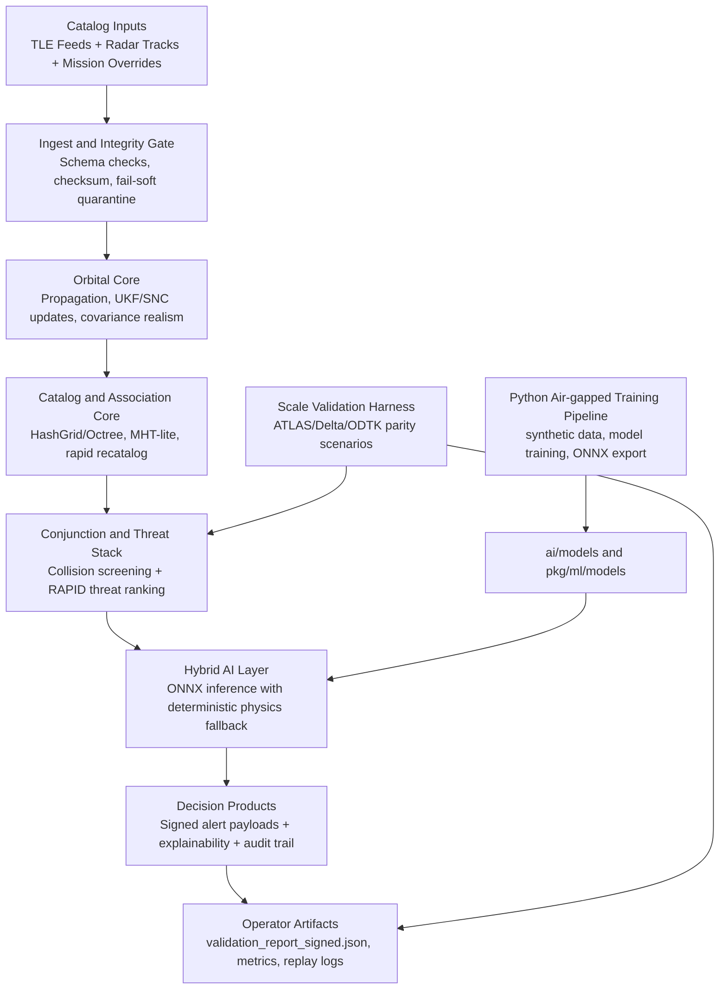

# Sovereign Space Intelligence Substrate (SSIS) Architecture

## Executive Summary
Sovereign Space Intelligence Substrate (SSIS) is an air-gapped, indigenous, defense-grade Space Domain Awareness platform for IAF ADITI 4.0 PS24 that fuses deterministic orbital physics with explainable AI in a single operational Go binary. The system ingests TLE and radar-derived observations, performs resilient catalog upkeep and conjunction analysis, applies confidence-gated ONNX models with strict classical fallback, and emits cryptographically signed alert artifacts and validation reports suitable for operator action, audit, and formal parity benchmarking against ATLAS/LeoLabs Delta/COMSPOC/ODTK workflows.

## High-Level Block Diagram

## End-to-End Data Flow
1. Inputs are loaded from mission catalogs (`assets/indian_satellite_catalogue.json`) and observation sources (TLE/radar-derived tracks).
2. Ingest applies schema and physics sanity checks, rejects malformed records with fail-soft handling, and preserves good records.
3. Orbital processing updates state estimates via propagation and filtering (`pkg/orbital`) including maneuver signals, covariance realism, and uncertainty handling.
4. Catalog services (`pkg/catalog`, `pkg/octree`, `pkg/spatial`) maintain indexed objects, perform association support, and optimize neighborhood queries.
5. Conjunction and threat logic computes close approaches and prioritization candidates.
6. Hybrid ML (`pkg/ml`) executes ONNX models when healthy and confident; deterministic classical physics is retained as the safety net and arbitration baseline.
7. Cryptographic controls (`pkg/crypto`) sign operational outputs and validation artifacts for chain-of-custody and replay integrity.
8. `cmd/ssa_ops_runner` emits signed reports, metrics, and operator-ready artifacts into `artifacts/` and validation-report paths.

## Repository Structure and Responsibilities
- `cmd/ssa_ops_runner`: single CLI delivery entrypoint and operational orchestration.
- `pkg/orbital`: propagation, UKF/SNC, covariance realism, maneuver characterization, and orbital state handling.
- `pkg/ml`: ONNX integration, evaluation harnesses, explainability, hybrid orchestration, and model-facing interfaces.
- `pkg/crypto`: signing and verification primitives for auditability and tamper evidence.
- `pkg/catalog`: catalog update logic, correlation, and rapid recatalog support.
- `pkg/common`: shared cross-cutting package namespace for reusable primitives and utilities.
- `pkg/octree`, `pkg/spatial`, `pkg/physics`: high-performance spatial indexing, coverage/hash-grid primitives, and deterministic physics support.
- `internal/legacy_engine`: legacy standalone engine entrypoint retained for traceability; not the primary delivery path.
- `ai/training`: synthetic data generation and model training/export pipeline (air-gapped Python workflow).
- `ai/models`: generated ONNX model drop for deployment and evaluator inspection.
- `assets`: sovereign catalogs and static mission data.
- `docs`: architecture, hardening, deployment, and validation documentation set.
- `scripts`: helper automation and repository utility scripts.
- `artifacts`: generated runtime outputs and signed validation products.

## Key Design Decisions
### Single Static Go Binary
SSIS operational delivery is centered on one hardened CLI binary (`ssa_ops_runner`) to reduce deployment complexity, simplify accreditation, and provide deterministic behavior in disconnected or classified environments.

### Hybrid Physics + AI
Deterministic orbital physics remains the authoritative baseline. AI models improve ranking, detection, and uncertainty exploitation, but confidence thresholds and fallback paths prevent opaque model behavior from overriding safe deterministic logic.

### Hardening and Cryptographic Signing
The pipeline enforces fail-soft ingest, explicit error visibility, and signed outputs with audit metadata. This supports evidentiary integrity, replayability, and formal review by operators and auditors.

### Scale Validation and External Parity Benchmarking
The evaluation harness executes high-load scenarios and writes signed validation reports designed to align with parity expectations against ATLAS, LeoLabs Delta, COMSPOC, and ODTK benchmark styles.

## Deployment and Usage (Air-Gapped)
1. Build the binary:
   - `go build ./cmd/ssa_ops_runner`
2. Optional model generation (air-gapped Python stack):
   - `SSIS_PYTHON_BIN=python3 go run ./cmd/ssa_ops_runner --generate-models --scale-test --catalog-size 100000 --scale-hours 168 --out ./artifacts/aditi_ops_scale --validation-report validation_report_signed.json`
3. Operational scale run (without retraining):
   - `go run ./cmd/ssa_ops_runner --scale-test --catalog-size 100000 --scale-hours 168 --out ./artifacts/aditi_ops_scale --validation-report validation_report_signed.json`
4. Optional static visualization can be hosted from `ssis_visualizer/` if present in deployment branch.

## Future Extensibility
- Promote `pkg/common` into richer typed contracts for sensor adapters, mission policies, and audit envelopes.
- Add additional sovereign sensor adapters behind deterministic interfaces without changing the binary contract.
- Expand model packs in `ai/models` with staged qualification tiers while preserving confidence-gated fallback policy.
- Add distributed deployment profiles for larger catalogs while retaining single-node deterministic mode for forward deployments.
