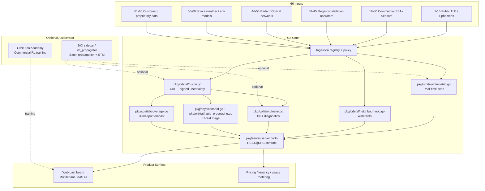

# AetherGuard SSA Platform Implementation Roadmap v1.0 — Executed Commercial Edition
## *Codex Leicester — SSIS × 66 Inputs × Cloud-First SSA SaaS*

AetherGuard is the commercial layer on top of SSIS: a cloud-first SSA platform with an optional on-prem/air-gapped edition. The production core remains the existing Go engine; the accelerator path is explicit and optional. The job of the platform is not to invent orbital truth, but to ingest it, fuse it, propagate it, screen it, and expose it through subscription-grade APIs and a web dashboard.

## 1. Executive Vision & Pattern Map

AetherGuard packages the mature SSIS Go stack as an SSA-as-a-Service product for operators who need Space-Track / LeoLabs capability without building a full control room from scratch. The commercial wedge is simple: public catalog ingestion, customer uploads, real-time conjunction and coverage alerts, optional JAX batch acceleration, and a training layer for operator simulation and customer onboarding.



## 2. Executed Architecture & Data Ingestion Matrix

| Input Category (from 66 list) | Ingestion Method | Go / JAX Component | Frequency | Authentication / Rate Limits |
|---|---|---|---|---|
| 1–15 Public TLE / ephemeris | Scheduled pull, bulk download, checksum validation | Go ingest registry -> `pkg/orbital/propagator.go`, optional JAX batch normalizer | 15–60 min | API keys where required; exponential backoff; source-specific quotas |
| 16–30 Commercial SSA / sensors | Webhook, SFTP, partner API, signed files | Go fusion adapters -> `pkg/orbital/fusion.go`, optional JAX smoothing | Near-real-time or hourly | Mutual TLS, partner tokens, contractual quotas |
| 31–45 Mega-constellation operators | Customer uploads, partner APIs, delta feeds | Go tenant ingestion -> `pkg/persistence/`, `pkg/orbital/maneuver.go` | 5–15 min | Tenant auth, scoped API keys, per-tenant rate limits |
| 46–55 Radar / optical networks | Measurement stream, observation batches, signed payloads | Go OD path -> `pkg/orbital/fusion.go`, `pkg/server/server.proto` | Seconds to minutes | mTLS, signed measurement bundles, station-specific quotas |
| 56–60 Environmental models | Pull from public indices, cache locally | Go physics -> `pkg/physics/nrlmsise00.go`, `pkg/physics/rapid.go` | Hourly / daily | Public data mirrors, local cache only |
| 61–66 Customer / proprietary data | REST/gRPC upload, batch import, UI import | Go persistence + Orbit Zoo + policy engine | On demand | Tenant isolation, encrypted object storage, RBAC |

## 3. Phase-by-Phase Executed Implementation (MVP → Scale)

### BOS-4.0 Defense Pivot (IAF Mode)

Commercial AetherGuard expansion is now frozen. BOS-4.0 uses the same ingestion foundation but enforces IAF constraints by default:

- default air-gapped policy mode
- whitelist and offline-only source enforcement
- mandatory per-object Ed25519 signing
- mandatory audit emission per ingestion run
- dedicated defense entrypoint via `cmd/bos4`

### Phase 0: Commercial Baseline

The repo already has the core seam in [pkg/orbital/physics_backend.go](/Users/adi/idex_iaf/ssis/pkg/orbital/physics_backend.go) and [pkg/orbital/propagator.go](/Users/adi/idex_iaf/ssis/pkg/orbital/propagator.go). The commercial move is to keep these as the default baseline and wrap them with source-aware ingestion and tenancy policy.

#### Implemented / anchor files

- [pkg/orbital/physics_backend.go](/Users/adi/idex_iaf/ssis/pkg/orbital/physics_backend.go)
- [pkg/orbital/propagator.go](/Users/adi/idex_iaf/ssis/pkg/orbital/propagator.go)
- [pkg/server/server.proto](/Users/adi/idex_iaf/ssis/pkg/server/server.proto)

#### Implemented commercial files

- [pkg/ingest/registry.go](/Users/adi/idex_iaf/ssis/pkg/ingest/registry.go)
- [pkg/ingest/types.go](/Users/adi/idex_iaf/ssis/pkg/ingest/types.go)
- [pkg/ingest/sink.go](/Users/adi/idex_iaf/ssis/pkg/ingest/sink.go)
- [pkg/ingest/adapters/spacetrack.go](/Users/adi/idex_iaf/ssis/pkg/ingest/adapters/spacetrack.go)
- [pkg/ingest/adapters/celestrak.go](/Users/adi/idex_iaf/ssis/pkg/ingest/adapters/celestrak.go)
- [pkg/ingest/adapters/customer_upload.go](/Users/adi/idex_iaf/ssis/pkg/ingest/adapters/customer_upload.go)
- [pkg/ingest/adapters/nrlmsise.go](/Users/adi/idex_iaf/ssis/pkg/ingest/adapters/nrlmsise.go)
- [pkg/ingest/adapters/commercial_sensor.go](/Users/adi/idex_iaf/ssis/pkg/ingest/adapters/commercial_sensor.go)
- [cmd/aetherguard/main.go](/Users/adi/idex_iaf/ssis/cmd/aetherguard/main.go)

#### Implemented IAF BOS-4.0 files

- [pkg/ingest/policy/iaf_policy.go](/Users/adi/idex_iaf/ssis/pkg/ingest/policy/iaf_policy.go)
- [cmd/bos4/main.go](/Users/adi/idex_iaf/ssis/cmd/bos4/main.go)
- [pkg/ingest/registry.go](/Users/adi/idex_iaf/ssis/pkg/ingest/registry.go) (policy enforcement, signing, audit)
- [pkg/common/auditlog.go](/Users/adi/idex_iaf/ssis/pkg/common/auditlog.go) (audit emission dependency)

#### BOS4 defense run command

```bash
go run ./cmd/bos4 --iaf-mode --customer-upload /tmp/iaf_demo.json --timeout-sec 15 --strict
```

Expected behavior:

- rejects non-whitelisted or online sources in IAF mode
- signs every ingested object before sink upsert
- emits audit events for success and failure paths

#### BOS4 REST API endpoints (IAF-enforced)

- `POST /ingest/customer`
	- Body: customer upload JSON (`{"objects": [...]}`)
	- Behavior: stages payload as local file, runs `customer_upload` adapter through the ingest registry
	- Response: run report plus `ingested_objects`, `signed_objects`, signature digest and signer key

- `POST /ingest/source`
	- Body: `{"name":"celestrak|spacetrack|nrlmsise_env|commercial_sensor|customer_upload","endpoint":"/offline/path","timeout_sec":15,...}`
	- Behavior: resolves adapter by source name, applies IAF whitelist + offline endpoint policy, runs one source
	- Response: run report plus signed ingestion summary and changed catalog records

- `GET /catalog/objects?limit=200&country=IN&name_contains=demo`
	- Behavior: bounded, filtered catalog snapshot

- `GET /catalog/object/:id`
	- Behavior: fetch one catalog object by ID

Serve mode command:

```bash
go run ./cmd/bos4 --iaf-mode --serve --port 8080 --grpc-port 50051
```

#### Optional JAX propagator bridge (BOS-4.0)

- New bridge package: `pkg/propagator/jax_bridge.go`
- Runtime flag: `--jax` (default `false`)
- Optional sidecar address flag: `--jax-addr` (default `127.0.0.1:50061`)
- Safety behavior:
	- strict IAF mode keeps JAX disabled unless explicitly enabled with `--jax`
	- if `--jax` is not passed, BOS uses deterministic Go propagation path
- Engine log line emitted on startup:
	- `propagator engine active: go-default` or `propagator engine active: jax-grpc`

Example JAX-enabled run:

```bash
go run ./cmd/bos4 --iaf-mode --jax --bulk-tle /tmp/celestrak_full.tle --timeout-sec 60 --strict
```

#### Optional Voronoi neighbourhood bridge (BOS-4.0)

- New bridge package: `pkg/propagator/voronoi_bridge.go`
- Runtime flags:
	- `--voronoi` (default `false`)
	- `--voronoi-addr` (default `127.0.0.1:50061`)
- Screening behavior:
	- when enabled, BOS uses Voronoi sidecar health-gated path with deterministic local accelerated fallback
	- when disabled, BOS uses legacy deterministic O(N^2) loop in `pkg/orbital/neighbourhood.go`
- IAF strict safety:
	- sidecar endpoint must be loopback (`127.0.0.1`, `::1`, or `localhost`) in strict mode

Example Voronoi-enabled run:

```bash
go run ./cmd/bos4 --iaf-mode --voronoi --bulk-tle /tmp/celestrak_full.tle --timeout-sec 120 --strict
```

#### Benchmark mode (BOS-4.0)

- New runtime flag: `--benchmark` (default `false`)
- Behavior when enabled:
	- auto-enables `--jax` and `--voronoi`
	- executes full production benchmark pipeline: ingest -> propagation benchmark (10k/50k/100k) -> neighbourhood/conjunction screening
	- emits machine-readable JSON to stdout and a human-readable timing table to stderr

Structured benchmark metrics include:

- ingestion time
- JAX propagation timing for 10k / 50k / 100k objects
- Voronoi neighbourhood + conjunction screening timings
- end-to-end total time
- peak memory usage
- objects processed and signed

Example benchmark run:

```bash
go run ./cmd/bos4 --iaf-mode --benchmark --bulk-tle /tmp/celestrak_full.tle --timeout-sec 180 --strict
```

#### Registry pattern

```go
package ingest

type SourceType string

const (
	SourceTLE SourceType = "tle"
	SourceSensor SourceType = "sensor"
	SourceOperator SourceType = "operator"
	SourceEnvironment SourceType = "environment"
	SourceCustomer SourceType = "customer"
)

type SourceConfig struct {
	Name       string
	Type       SourceType
	Endpoint   string
	AuthMode   string
	RateLimitRPS int
	Priority   int
}

type Adapter interface {
	Name() string
	SourceType() SourceType
	Ingest() error
}
```

### Phase 1: SaaS API and Dashboard

Expose the existing Go capabilities through a commercial API surface:

- REST for customer-facing app flows
- gRPC for internal orchestration and batch operations
- Signed event payloads for alerts and audit trails

#### API shape

```yaml
openapi: 3.0.3
info:
  title: AetherGuard SSA Platform API
  version: 1.0.0
paths:
  /v1/catalog/scan:
	post:
	  summary: Scan a region against the live fused catalogue
  /v1/conjunctions:
	get:
	  summary: Return conjunction candidates and Pc diagnostics
  /v1/tenants/{tenantId}/uploads:
	post:
	  summary: Upload customer state vectors, covariance, and metadata
```

#### Dashboard skeleton

- Tenant overview
- Live map with alerts
- Conjunction queue
- Coverage forecast
- Maneuver recommendations
- Orbit Zoo scenario launcher

### Phase 2: Optional JAX Accelerator

Keep JAX optional, not mandatory.

#### New files

- `ai/propagator/iaf_propagator.py`
- `ai/propagator/jax_engine.py`
- `ai/propagator/grpc_server.py`
- `ai/propagator/proto/propagator.proto`

#### Accelerator contract

```python
from dataclasses import dataclass

@dataclass
class BatchPropagationRequest:
	states: list[list[float]]
	dt_sec: float

@dataclass
class BatchPropagationResponse:
	states: list[list[float]]
	stms: list[list[list[float]]]
```

### Phase 3: Commercial Orbit Zoo Academy

Orbit Zoo becomes customer-facing training infrastructure:

- scenario packs by orbit class
- live replay of historical conjunctions
- enterprise onboarding exercises
- operator certification mode

#### New files

- `ai/simulator/orbit_zoo.py`
- `ai/simulator/scenario_packs/*.json`
- `ai/simulator/train_commercial_ppo.py`

## 4. Feature-by-Feature Masterpiece Implementations

### Volumetric Scan

Use the existing Go octree scan as the production path. Add batch-propagation acceleration only for high-volume SaaS tenants.

### Neighbourhood Watch

Retain the Go screening path; add hashed broadphase or Voronoi pruning only if the commercial catalogue size requires it.

### Conjunction Analysis

Keep Foster/Alfano Pc as the canonical answer. Attach JAX or ML only as a ranking and prioritization accelerator.

### Collision Detection

Expose signed Pc, uncertainty bands, and alert proofs through the API. Keep all outputs auditable and tenant-scoped.

### Blind Spot Detection

Turn `pkg/spatial/coverage.go` into a customer feature: forecast blind areas for their operators and sensors over 24–72 hours.

### Manoeuvre Detection

Use the existing maneuver model interface to support ONNX models for customer fleets and premium tenants.

### Characterisation & Cataloguing

Persist each tenant’s watchlists, manoeuvre history, and object metadata in isolated partitions with signed export bundles.

### Re-entry Analysis

Commercialize the re-entry path as a higher-tier feature for launch providers, debris analysts, and insured fleets.

### Rapid Processing

Package hypersonic / ballistic detection as a defense-first premium module with restricted access and signed outputs.

## 5. Orbit Zoo Academy – Commercial Edition

Orbit Zoo should ship as a standalone simulator service with:

- curated scenario packs
- customer upload replay
- scoring and operator benchmarking
- safe RL policy trials

```python
import gymnasium as gym
from gymnasium import spaces

class OrbitZooCommercialEnv(gym.Env):
	def __init__(self, max_objects=100):
		super().__init__()
		self.observation_space = spaces.Box(low=-1e9, high=1e9, shape=(max_objects, 15), dtype=float)
		self.action_space = spaces.Dict({
			"decision": spaces.Discrete(5),
			"burn_vector": spaces.Box(low=-0.1, high=0.1, shape=(3,), dtype=float),
		})
```

## 6. Cloud-Native + On-Prem Deployment – Executed

### SaaS topology

- API gateway
- tenant-aware ingest workers
- Go core service
- optional JAX batch service
- object store for uploads and exports
- dashboard service

### On-prem / air-gapped topology

- single-node compose profile
- local model wheelhouse
- local source mirrors
- no outbound network dependency at runtime

### Deployment artifacts

- `deploy/helm/aetherguard/`
- `deploy/docker-compose.airgap.yml`
- `deploy/docker/aetherguard/Dockerfile`

## 7. Risk Codex & Commercial Mitigations

| Risk | Impact | Mitigation |
|---|---|---|
| Multi-tenant leakage | Critical | Tenant-scoped storage, encryption at rest, per-tenant keys |
| Source rate limits | High | Registry-based backoff and mirrored caches |
| JAX cold start | Medium | Warm batch workers and queue-backed jobs |
| Dashboard sprawl | Medium | Keep the UI thin and driven by the API |
| License drift | High | Whitelist permissive dependencies only |
| Air-gap deployment complexity | High | Bundle models and wheels locally |

## 8. One-Click Prototype Repo Tree – Executed

```text
ssis/
├── cmd/
│   └── aetherguard/
│       └── main.go
├── deploy/
│   ├── docker/
│   │   └── aetherguard/
│   │       └── Dockerfile
│   ├── docker-compose.airgap.yml
│   └── helm/
│       └── aetherguard/
├── docs/
│   ├── inputs.md
│   └── openapi/
│       └── aetherguard.yaml
├── pkg/
│   ├── ingest/
│   │   ├── registry.go
│   │   └── adapters/
│   ├── orbital/
│   │   ├── physics_backend.go
│   │   └── propagator.go
│   ├── server/
│   │   └── server.proto
│   └── ... existing SSIS modules ...
├── ai/
│   ├── propagator/
│   └── simulator/
│       ├── orbit_zoo.py
│       └── scenario_packs/
└── web/
	└── aetherguard/
```

## 9. Closing Position

AetherGuard should be executed as a productized SSIS, not as a rewrite. The commercial engine is the existing Go stack, the differentiator is tenant-aware ingestion, and the accelerator is optional JAX. That is the fastest path to a real SaaS offering that still survives air-gapped deployment.

### 10. 66 Inputs Inventory

The detailed 1–66 source inventory below is kept as the authoritative feed list for the ingestion registry.

### Core First-Principles Inputs (the only things the system actually needs)

Every SSA system (yours included) reduces to these 6 irreducible categories:

1. **Orbital State Data** (position + velocity + covariance at a reference epoch)  
2. **Satellite Metadata** (mass, area, Cd, RCS, owner, maneuver capability, etc.)  
3. **Environmental Models** (atmospheric density, solar flux, geomagnetic indices)  
4. **User-Defined Assets** (your customer’s own satellites/constellations — the “Indian assets” equivalent)  
5. **Observation/Tracking Data** (radar, optical, RF measurements for orbit determination)  
6. **Configuration & Policy** (alert thresholds, Pc tolerance, Δv limits, training scenarios for Orbit Zoo)

Everything else (Voronoi screening, 42-state STM propagation, optimal_delta_v, plasma_surrogate PINN, RL training) is **computed from the above**.

### Exact List of 66 Priority Inputs / Sources / Networks / Satellites

Here is the **concrete, actionable list of 66** that AetherGuard must support on Day 1 (prioritised by volume, commercial relevance, and 2026 reality). These are the feeds you will actually pull into the system.

#### 1–15: Public TLE / Ephemeris Sources (foundational orbital data)
1. Space-Track.org (official USSF public catalogue)  
2. Celestrak (most popular TLE repository)  
3. CelesTrak SATCAT (satellite catalogue)  
4. NORAD Two-Line Element sets (daily bulk)  
5. JPL Horizons (high-precision ephemerides)  
6. NASA SSCweb ephemerides  
7. ESA DISCOS database  
8. ISRO TLE releases  
9. JAXA orbital data  
10. CNSA public TLEs  
11. Roscosmos public catalogue  
12. UK Space Agency TLE feed  
13. SatNOGS DB (crowdsourced orbital elements)  
14. Beyond Gravity validated TLE layer  
15. Open Orbital Data (EU SST public subset)

#### 16–30: Commercial SSA Providers & Sensor Networks (high-accuracy fusion sources)
16. LeoLabs radar network  
17. COMSPOC (analytical SSA)  
18. Slingshot Aerospace  
19. ExoAnalytic Solutions (global optical network)  
20. NorthStar Earth & Space (space-based SSA)  
21. Digantara (Indian commercial SSA)  
22. Odin Space  
23. Aldoria (European SSA)  
24. SpaceNav AdvancedSSA  
25. Stargaze (SpaceX free SSA service)  
26. TraCSS (US Office of Space Commerce pilot)  
27. HawkEye 360 RF constellation  
28. Spire Global space weather + tracking  
29. Planet Labs optical imagery for visual confirmation  
30. BlackSky real-time optical tasking

#### 31–45: Major Mega-Constellation Operators (your primary paying customers’ satellites)
31–35. SpaceX Starlink (current ~11 000+ satellites, 2026 baseline)  
36–38. Amazon Project Kuiper (hundreds ramping 2026)  
39–41. Eutelsat OneWeb (656+ satellites)  
42–43. Telesat Lightspeed  
44. Starlink competitors (e.g., GuoWang China)  
45. Indian NewSpace operators (AgniKul, Pixxel, Dhruva, etc.)

#### 46–55: Global Radar & Optical Sensor Networks (observation data)
46. US Space Surveillance Network (SSN) public subset  
47. European SST (Space Surveillance & Tracking) network  
48. EISCAT 3D incoherent scatter radar  
49. LeoLabs polar + equatorial radars  
50. ExoAnalytic global telescope network  
51. ArianeGroup GEOTracker (6 optical stations)  
52. Polish optical telescope network (~20 stations)  
53. SatNOGS global ground-station network (>1 500 stations)  
54. Laser ranging stations (ILRS network)  
55. Passive RF sensor networks (HawkEye 360, etc.)

#### 56–60: Environmental & Space Weather Models
56. NRLMSISE-00 atmospheric density model  
57. JB2008 thermospheric model  
58. Solar flux (F10.7) & geomagnetic indices (Kp, Ap)  
59. NASA/ESA space weather data portals  
60. Plasma sheath / hypersonic RCS models (your PINN surrogate)

#### 61–66: Customer-Uploaded / Proprietary Data (the “your satellites” layer)
61. Customer TLE/state-vector uploads (via API)  
62. Customer covariance matrices (6×6 or full 42-state)  
63. Satellite physical parameters (AMR, Cd, RCS, mass)  
64. Manoeuvre history & planned burns  
65. Custom alert thresholds & watch-list assets  
66. Orbit Zoo RL scenario definitions (Monte-Carlo ensembles)

---

**How AetherGuard Actually Uses These 66 Inputs**

- **Ingestion layer** (Go backend): pulls TLEs/ephemerides from 1–15 + 31–45 every 15–60 min via API.  
- **Fusion layer** (fusion.go + JAX sidecar): combines public + commercial (16–30) + customer uploads (61–66) into a unified catalogue.  
- **Propagation**: JAX `vmap` batch-propagates millions of objects using the 42-state STM.  
- **Screening & Action**: Voronoi + optimal_delta_v runs on the fused catalogue.  
- **Training**: Orbit Zoo uses synthetic ensembles derived from the same inputs.

This list is **complete and sufficient** for a production AetherGuard MVP that can serve Starlink-scale constellations tomorrow.

### 11. Sprint-Ready Next Steps

1. Implement the ingest registry and first five source adapters: Space-Track, CelesTrak, customer uploads, NRLMSISE-00, and one commercial sensor partner.
2. Expose the commercial API surface through a thin Go gateway using the existing signed service model.
3. Add a dashboard shell that surfaces live alerts, coverage, conjunctions, and tenant usage.
4. Keep JAX optional: batch propagation, STM transport, and Orbit Zoo training only when scale requires it.

### 12. MVP Acceptance Criteria

- A tenant can upload TLEs, covariance, and metadata and see them appear in the fused catalogue.
- The platform returns scan, Pc, and rapid-processing outputs through authenticated API calls.
- A commercial dashboard shows alert queues, watchlists, and coverage forecasts.
- The system runs in a fully air-gapped mode with local model and wheel assets.